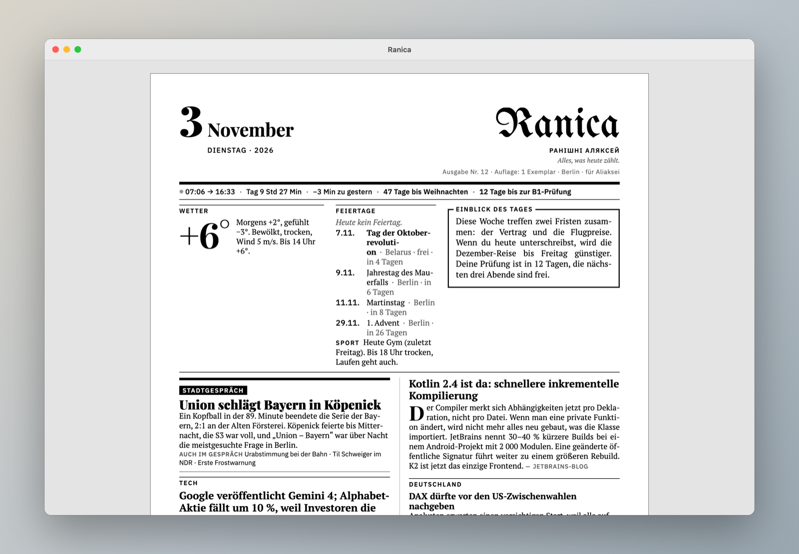
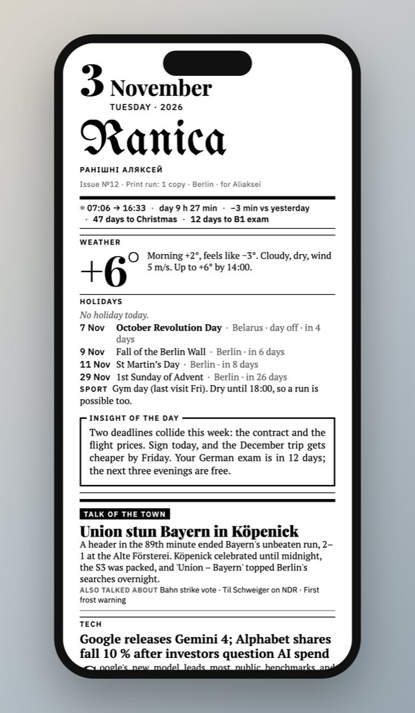
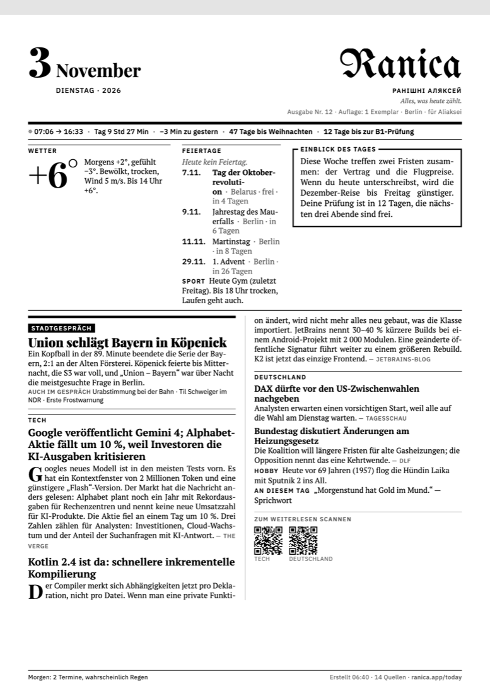

  

<h1 align="center">Ranica</h1>

  Your day on one printed page, every morning. 
  A personal newspaper for Berlin, written fresh before you wake up.

  
  
  
  
  

## Get it

Open **[zeitung.aliaksei.xyz/today](https://zeitung.aliaksei.xyz/today)** and install it as an app
(the old address, `ranica.aliaksei-zhynhiarouski.workers.dev`, still works):

- **macOS** — in Safari choose **File ▸ Add to Dock**; in Chrome or Edge click the install icon in the address bar.
- **iPhone** — in Safari tap **Share ▸ Add to Home Screen**.
- **Paper** — print the page; it is laid out as two A4 sheets, front and back.

Editions you have opened stay readable offline.

| Phone | Print |
|---|---|
|  |  |

## What is on the page

- **The news that matters**: Berlin, transport, Germany, the world and business, picked from tagesschau,
  Tagesspiegel, rbb24, Berliner Morgenpost and Handelsblatt. Each story appears once, and nothing from
  the last two days comes back unless something new happened.
- **Stadtgespräch**: the one thing Berlin and Germany are talking about today, from a football
  result to a scandal, based on what people search for right now, plus a few other topics.
- **Einblick des Tages**: a short note that connects today's facts into something useful.
- **Weather, sunrise and holidays** for Berlin and Belarus.
- **Telegram digest** in the channel's own language.
- **German practice**: the edition is written in natural German at B1, with a word of the day and the
  harder words of today's text explained. English is available too.

## How it works

Every hour Ranica collects the sources. Shortly before your wake time Claude reads everything that is
new, picks and rewrites the stories into the page, and stores the edition. Without Claude a simple
editor fills the page with the newest items. Everything runs on Cloudflare's free tier.

---

[Building and deploying](docs/building.md) · [Plan](docs/02-plan.md) · [Design brief](docs/03-design-brief.md)
